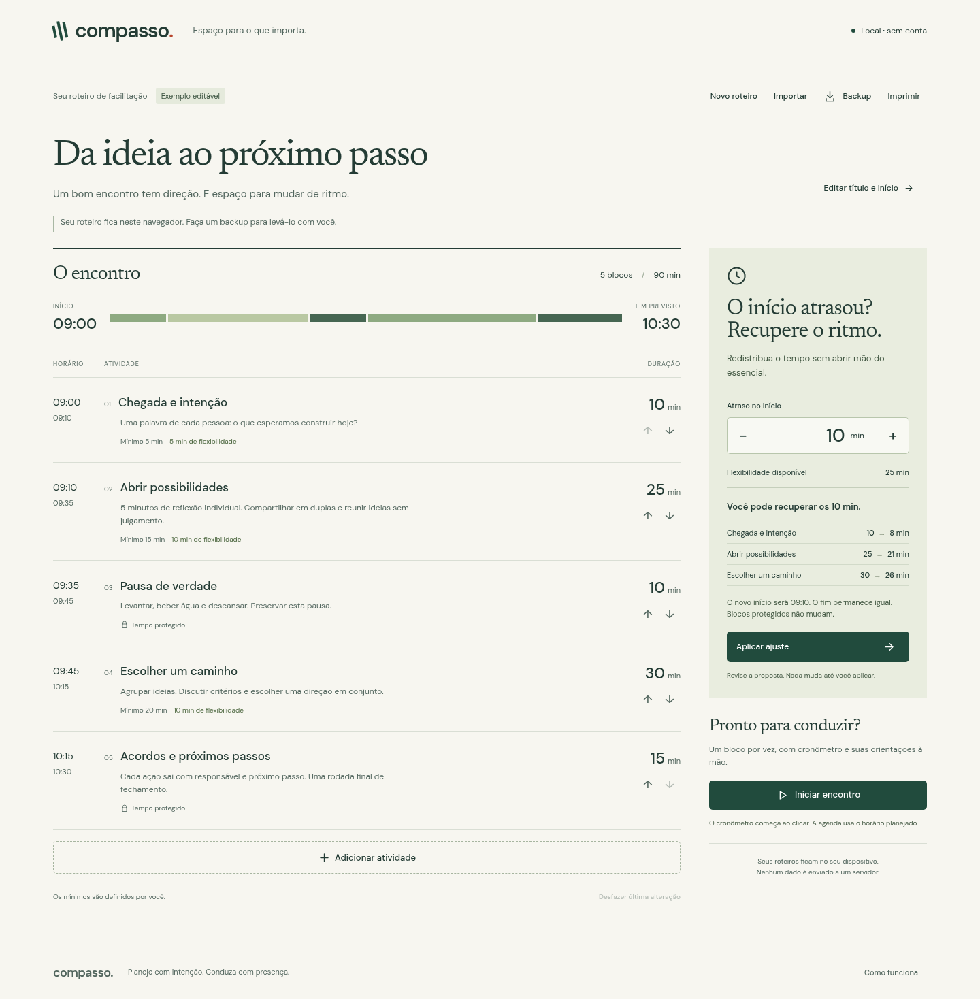

# Compasso

Um roteiro de workshop que recupera atrasos no início, respeitando o tempo mínimo e as atividades protegidas.



## Rodar localmente

Requisitos: Node.js 22 ou 24 LTS e npm. Validado nesta sessão com Node 24.22.1 e npm 11.9.0, em Linux. No Windows (PowerShell) e macOS (Terminal), abra a pasta extraída do projeto e execute os mesmos comandos:

```sh
npm ci
npm run dev
```

Abra o endereço local informado pelo Vite, normalmente `http://127.0.0.1:5173`. Mantenha o terminal aberto. Ctrl+C encerra o servidor. Nenhuma conta, chave de API ou arquivo `.env` é necessário. A instalação baixa dependências do npm; depois, a aplicação não faz chamadas externas. Fontes são servidas localmente.

Build estático e verificação da versão compilada:

```sh
npm run build
npm run preview
```

Use sempre o mesmo endereço, porta e navegador para recuperar os dados locais: localStorage é separado por origem. Exportar/importar é a forma de transferir dados entre o modo dev, preview e outra máquina. Não abra `index.html` diretamente pelo explorador de arquivos.

## Primeiro uso

1. Abra o exemplo, identificado como **Exemplo editável**. Clique no nome de uma atividade para editar duração, mínimo e orientações.
2. Proteja os blocos que não podem perder tempo. Reordene pelas setas ou crie atividades.
3. Informe dez minutos de atraso. Confira os cortes propostos e clique em **Aplicar ajuste**. O início avança dez minutos; o fim previsto é preservado.
4. Clique em **Iniciar encontro**. Pause, retome e avance manualmente de bloco. O cronômetro real não segue automaticamente o horário nominal da agenda.
5. Exporte **Backup** antes de fechar ou transportar. **Importar** valida e restaura o JSON. **Imprimir** abre a impressão do navegador, que permite salvar PDF.

O exemplo só se torna um roteiro persistido quando você altera algo ou inicia a condução. A aplicação conserva um roteiro por navegador/origem. **Novo roteiro** pede confirmação; **Desfazer última alteração** restaura uma edição, exclusão, reordenação, importação ou ajuste enquanto a página estiver aberta. O histórico de desfazer não sobrevive à recarga. Limpar dados do navegador remove o roteiro. Use uma aba por vez: esta versão não sincroniza edições concorrentes.

## Como a recuperação funciona

Cada bloco não protegido disponibiliza `duração − mínimo` minutos. O atraso é distribuído proporcionalmente a essa folga. Os cortes são inteiros: usamos os maiores restos, com desempate pela ordem do roteiro. Exemplo: folgas 5, 10 e 10 com atraso 10 resultam em cortes 2, 4 e 4. Blocos protegidos cedem zero, mesmo quando têm mínimo menor que a duração.

Se a folga total não for suficiente, a interface informa o déficit e bloqueia a aplicação. A proposta é uma decisão aritmética, não uma avaliação pedagógica; você define os mínimos e revisa o resultado. Ajustes repetidos são incrementais, sempre sobre o roteiro atual.

Limites: 60 blocos, duração de 1 a 240 minutos por bloco, até 12 horas por roteiro, fim até meia-noite do mesmo dia, atraso até 240 minutos e importação até 200 KB. A condução bloqueia edição e recuperação até ser encerrada. Alterar o relógio do dispositivo pode alterar o cronômetro; não há sinal sonoro nem avanço automático.

## Estrutura e testes

- `src/domain.js`: regras puras, validação e distribuição dos cortes.
- `src/main.js`: interação, armazenamento local, arquivos e condução.
- `src/style.css`: visual responsivo e impressão.
- `tests/domain.test.js`: regras, fronteiras e invariantes.
- `tests/browser.mjs`: fluxo no Chromium, capturas e evidência estruturada.

```sh
npm test
npm run build
npx playwright install chromium
npm run test:e2e
```

O teste usa `/usr/bin/chromium` quando disponível; em outras máquinas usa o Chromium instalado pelo Playwright. Opcionalmente configure `CHROMIUM_PATH` com um executável existente. O script inicia e encerra seu próprio servidor na porta 4178 e usa um contexto de navegador isolado, sem acessar seus perfis. Linux pode precisar das dependências de sistema documentadas pelo Playwright. A aplicação em si não depende de Playwright para funcionar.

## Entrega e limites

Pronto para uso local de uma pessoa, com persistência no navegador e portabilidade por JSON. Sem autenticação, nuvem ou integração externa. Não há credenciais pendentes. O build pode futuramente ser servido em uma hospedagem estática HTTPS; nenhum deploy foi realizado. Antes de uma oferta pública: validar com facilitadores, realizar auditoria de acessibilidade, testar Safari/Firefox e dispositivos reais, definir política de dados e suporte. Colaboração, biblioteca de múltiplos roteiros, sincronização, contas e cobrança ainda exigiriam implementação.

- [Decisão e fontes da pesquisa](docs/DECISAO.md)
- [Verificações e limitações](docs/TESTES.md)
- [Demonstração em três minutos](docs/DEMO.md)
- [Estado para continuidade](STATUS.md)
- [Recursos e licenças](docs/RECURSOS.md)

O ZIP `compasso-entrega.zip` contém código, lockfile, documentação e capturas. Dependências e build são reconstruídos com os comandos acima; dados pessoais do navegador não entram no pacote.
